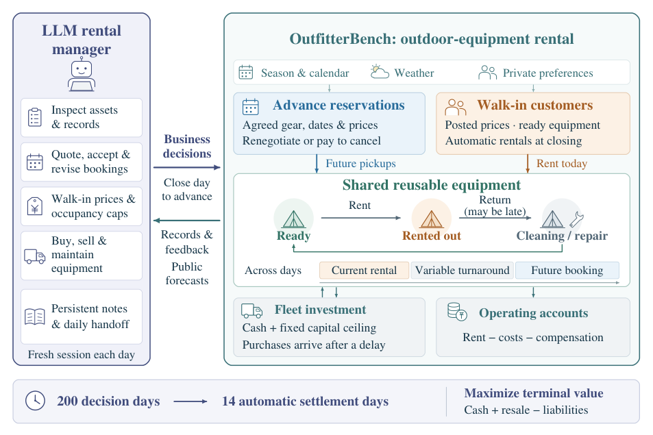
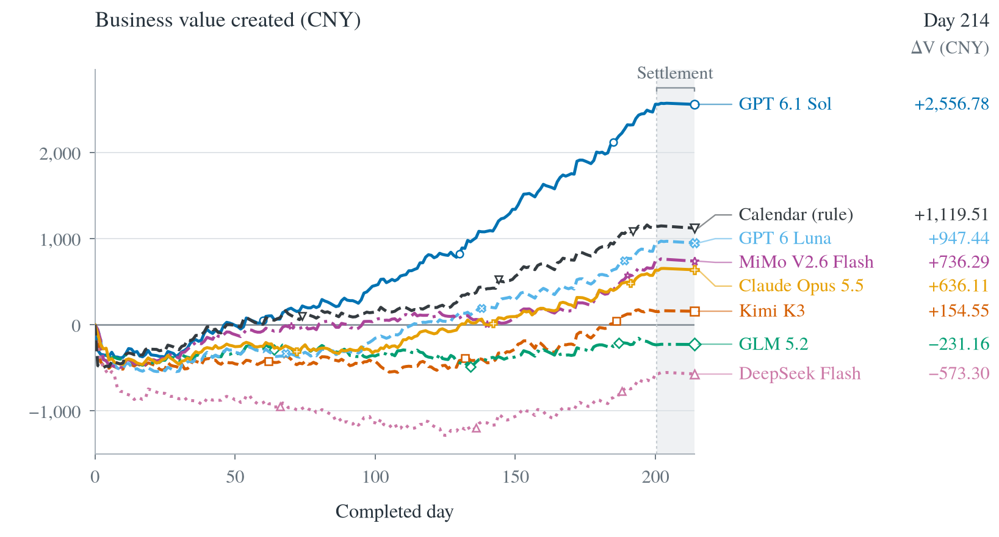

# OutfitterBench

### Evaluating LLM Agents on Long-Horizon Resource Allocation and Commitment Coordination

[](pyproject.toml)
[](LICENSE)

OutfitterBench is a simulated outdoor-equipment rental business in which an
agent manages **200 days of operations**, followed by **14 automatic settlement
days**. Reservations and walk-in customers compete for the same equipment as it
cycles through rental, return, cleaning, and maintenance. The objective is to
create long-term business value, not simply to accept more bookings or collect
more rent.

<p align="center">
  
</p>

**Release note.** This distribution keeps the V54 business mechanisms and
ships an independently constructed public weather dataset,
`beijing-2023-noaa-era5-v1`. The paper used a different frozen weather input.
Results from the two inputs must be identified separately. See
[weather data and versioning](docs/WEATHER.md).

[Quick start](#quick-start) · [Run an agent](#run-an-llm-agent) ·
[Evaluation](#scoring-and-trajectory-analysis) · [Paper results](#paper-results) ·
[Data](#data-and-license) · [Contributing](CONTRIBUTING.md)

## What does OutfitterBench test?

An agent's choices create constraints for its later decisions. Accepting a
reservation commits future equipment time; renting that equipment today can
jeopardize the booking, while protecting too much capacity can exclude valuable
business. Profitable operation requires both:

- **Maintaining feasible plans over time:** anticipating when equipment becomes
  usable, preparing supply, and keeping new decisions compatible with existing
  commitments.
- **Valuing and reallocating resources:** comparing bookings and walk-in demand,
  choosing prices and configurations, and reconsidering which assets and
  commitments deserve continued support.

The environment combines fixed-term reservation offers, manager-priced inquiries,
walk-in demand, supplier orders and trials, shared cleaning capacity, maintenance,
rescheduling, cancellation compensation, and equipment resale. A revolving
equipment-capital ceiling constrains fleet expansion even when cash increases.
Customers and operational outcomes use rule-based, seeded mechanisms; no customer
LLM or LLM judge is required.

The default rental configuration starts with CNY 3,000 cash and 27 equipment units. It uses
a CNY 15 daily operating fee and CNY 1,000 additional equipment-capital headroom.
The initial fleet's capital basis is separate from this headroom. Full defaults
are in [the configuration](configs/outfitter_v54_main.example.yaml).

## Quick start

Python **3.11–3.13** is required. Linux is recommended; the parallel offline
evaluator uses POSIX file locking. Install [uv](https://docs.astral.sh/uv/) first.

```bash
git clone https://github.com/adminblackjack/OutfitterBench.git
cd OutfitterBench
uv sync --extra dev --frozen
uv run outfitter-bench --help
```

Until the public release, cloning requires GitHub access to this private repository.

Try three days with the Calendar rule baseline, **without an API key**:

```bash
uv run outfitter-bench baseline \
  --config configs/outfitter_v54_main.example.yaml \
  --run-id calendar-quickstart --stop-after-day 3
```

This keeps the full 200+14-day world. See [Calendar](#calendar-a-no-llm-baseline)
below to continue the run or launch a full season.

## Run an LLM agent

Copy the rental configuration and set your model's connection parameters:

```bash
cp configs/outfitter_v54_main.example.yaml configs/local_main.yaml
export OUTFITTER_API_KEY="YOUR_API_KEY"
```

Edit these fields in `configs/local_main.yaml`:

```yaml
seed: 42
model: YOUR_MODEL_ID
base_url: https://YOUR_PROVIDER/v1
api_key_env: OUTFITTER_API_KEY
reasoning_effort: high
```

The runner uses an OpenAI-compatible **Chat Completions** endpoint with tool
calling. Set `reasoning_effort` to a supported value, or `null` if unsupported.
Review `temperature`, `max_output_tokens`, `thinking_type`, and
`provider_extra_body` for your model. These settings are not universally portable
between providers. Keep credentials in environment variables, not YAML or Git.

### Short test, then resume the same season

```bash
uv run outfitter-bench run --config configs/local_main.yaml \
  --run-id my-model-seed42 --stop-after-day 3

uv run outfitter-bench inspect runs/outfitter/my-model-seed42

uv run outfitter-bench resume runs/outfitter/my-model-seed42 \
  --stop-after-day 10

# Continue through the end of the season.
uv run outfitter-bench resume runs/outfitter/my-model-seed42
```

`--stop-after-day` is an **absolute business-day stopping point**. It preserves
the 200+14-day world. In contrast, `--days` changes the decision horizon and
should not be used to shorten a paper-protocol smoke test. Resume with the same
implementation and the run's frozen data; incompatible versions are rejected.

### Start a full season

```bash
uv run outfitter-bench run --config configs/local_main.yaml --run-id full-seed42
```

Use a separate configuration with `seed: 73` for another world. Each run
writes its configuration and data snapshot, SQLite trajectory, and summary under
`runs/outfitter/RUN_ID/`. Run directories are ignored by Git. Replacing the bundled
weather does not migrate existing runs: they retain their frozen inputs.

## Calendar: a no-LLM baseline

Calendar is the fixed, public-information rule policy used in the paper. It
applies a nominal reservation calendar, fixed prices and assortment rules, and
capacity protection. It is a reference policy, not an optimal planner. The
released runner does not need an API key or a pre-existing model trajectory.

```bash
# Three-day installation check; the underlying season remains 200+14 days.
uv run outfitter-bench baseline \
  --config configs/outfitter_v54_main.example.yaml \
  --run-id calendar-seed42 --stop-after-day 3

# Continue Calendar without constructing an LLM client.
uv run outfitter-bench baseline --resume runs/outfitter/calendar-seed42
```

For a full run from the start, omit `--stop-after-day`. Use `baseline --resume`,
not the LLM `resume` command, for Calendar trajectories.
The policy is unchanged, but new runs use the public weather bundled here.

## Scoring and trajectory analysis

The primary paper result is **ΔV**, the change in business value from the initial
shop to the end of settlement. Equipment value and outstanding obligations
matter alongside cash. An interrupted run has no final season score.

```bash
uv run outfitter-bench analyze runs/outfitter/my-model-seed42
uv run outfitter-bench evaluate runs/outfitter/my-model-seed42 --through-day 3
```

Outputs are saved inside the run's `analysis/` directory. Basic analysis is
offline and makes no model calls. It covers financial outcomes, service delivery,
resource use, and execution statistics.

**Extended evaluation is optional and can be expensive.** It replays historical
states and tests local capacity-relaxation alternatives. It is never enabled by
the ordinary `analyze` command.

```bash
# Example for a completed full-season run.
uv run outfitter-bench evaluate runs/outfitter/full-seed42 \
  --through-day 214 --extended --workers 1 --cpu-budget 8

uv run outfitter-bench diagnostics runs/outfitter/full-seed42 --through-day 214
```

Use `--source-root` with matching frozen source when evaluating an older run.
Diagnostics summarize behavior; they are not added to the reward or treated as
proof of optimality. See the [evaluation guide](src/outfitter/evaluation/README.md)
for definitions, version checks, parallelism, and replay-cache behavior.

## Paper results

<p align="center">
  
</p>

*Historical paper results under the original Visual Crossing-derived weather,
averaged equally over seeds 42 and 73. Curves show contract-adjusted economic
value change; right-hand labels report mean official ΔV at Day 214. Shading marks
automatic settlement. These experiments were not rerun with the public weather
and are not a leaderboard for the replacement dataset.*

Weather differences can affect requests, cancellations, returns, and later
allocations. New results should report the weather dataset identity alongside
their configuration and seed; they must not be silently merged into the
historical comparison. Model trajectories are not included, and their release
is not promised.

## Repository layout

```text
src/outfitter/              environment, tools, agent runner, and analysis
  runtime/                 operational transitions
  runtime_data/            fixed benchmark inputs
  evaluation/              offline metrics and optional historical replay
configs/                   example configurations (no credentials)
data_sources/weather/      open weather inputs and per-day provenance
scripts/                   public weather download utility
tests/                     regression and release tests
assets/                    environment overview and historical paper results
docs/                      data provenance and release guidance
```

## Data and license

- **Products:** Taobao listing information mapped to functional service profiles
  and equipment capacities, with benchmark-specific operating parameters.
- **Public weather:** NOAA observations at Beijing Capital Airport, ERA5 daily
  weather via Open-Meteo, and ERA5-Land snow depth. Open input snapshots and an
  offline builder are included. Normal runs need no weather API access.
- **Simulation:** fixed business rules and event-indexed random draws, with
  run-local snapshots and integrity checks.

Verify the shipped weather against its open inputs:

```bash
uv run python -m outfitter.public_weather --check
```

Read [weather construction and alignment](docs/WEATHER.md) and
[the paired no-LLM impact check](docs/WEATHER.md#paired-business-impact-check),
alongside [data provenance and licensing](docs/DATA.md). The code is
[Apache-2.0](LICENSE); third-party data retain their own terms and attribution
requirements.

Maintainers should complete the [public-release checklist](docs/RELEASE_CHECKLIST.md)
before changing visibility. This preparation keeps the repository private.

## Contributing and citation

See [CONTRIBUTING.md](CONTRIBUTING.md) for testing and change guidelines. The paper
is **OutfitterBench: Evaluating LLM Agents on Long-Horizon Resource Allocation and
Commitment Coordination**. Its arXiv link and BibTeX entry will be added when the
preprint is available.
